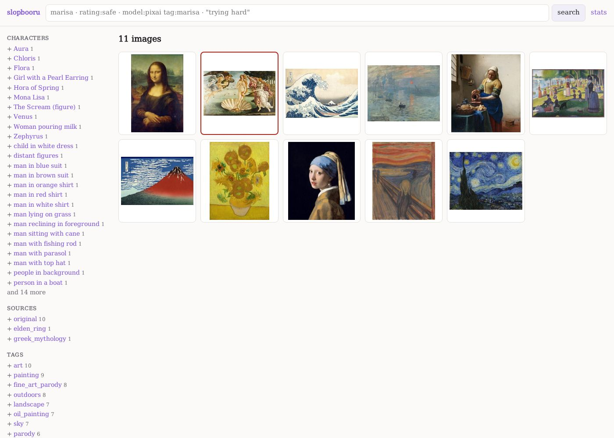
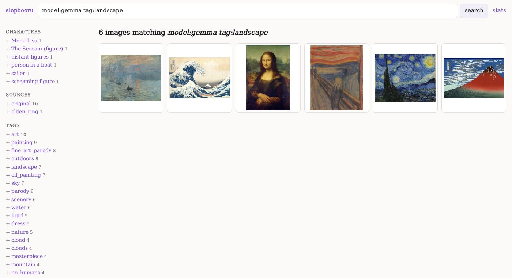
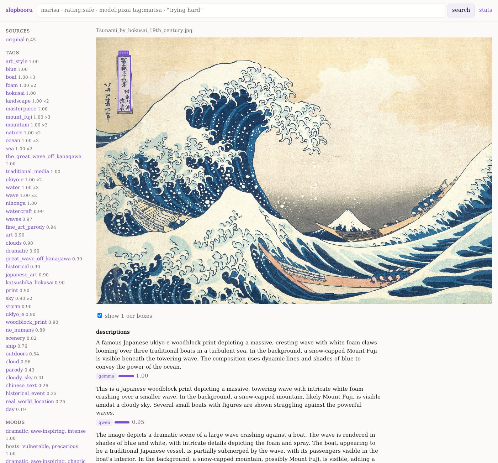

> slop alert: llm-generated prose follows. sorry. -norn

# slopbooru

A small booru for browsing what a fleet of image models said about a
folder of pictures: tags, characters, ratings, descriptions, text read out
of the picture, safety verdicts. Every value shows which model said it and
how confident that model was.

It's one program with nothing to install. Download the file for your
system, point it at a results database and the folder of pictures, and
open it in your browser. It can also ask the models itself
(`slopbooru classify`), through any server that speaks the OpenAI API.



<sub>The pictures in these screenshots are public-domain paintings from
Wikimedia Commons; the tags, descriptions and verdicts are what the fleet
in this repository said about them.</sub>

## Contents

- [Getting it](#getting-it)
- [Running it on Windows](#running-it-on-windows)
- [Running it on Linux](#running-it-on-linux)
- [What's on the site](#whats-on-the-site)
- [Editing by hand](#editing-by-hand)
- [Classifying](#classifying)
- [The fleet](#the-fleet)
- [Building](#building)
- [Tests](#tests)

## Getting it

There's one file per system, with nothing else needed:

| system | file |
|---|---|
| Windows 10 or 11, most PCs | `slopbooru-VERSION-windows-amd64.exe` |
| Windows on ARM | `slopbooru-VERSION-windows-arm64.exe` |
| Linux, most PCs | `slopbooru-VERSION-linux-amd64` |
| Linux on ARM (Raspberry Pi 4/5, ARM servers) | `slopbooru-VERSION-linux-arm64` |

You can download them from the
[Releases](https://github.com/warmdarksea/slopbooru/releases) page. The
Linux files run on any distribution, since they don't use the system's C
library. `SHA256SUMS` next to them lets you check a download.

You also need two things:

- **a results database** (`results.db`), the file the models' answers are
  stored in. `slopbooru classify` makes one (see [Classifying](#classifying)),
  or someone gives you theirs;
- **the folder of pictures** it describes. The folder doesn't need to be
  laid out or named the way it was on the machine that made the database,
  because pictures are matched by their content, not their names.

## Running it on Windows

1. Put `slopbooru-...-windows-amd64.exe` somewhere convenient, for example
   in the same folder as `results.db`. You can rename it to `slopbooru.exe`.
2. Open a terminal in that folder: in Explorer, right-click an empty part of
   the folder and choose **Open in Terminal** (or type `powershell` in the
   address bar and press Enter).
3. Run it, giving it the database and the picture folder:

   ```powershell
   .\slopbooru.exe --db results.db --images "C:\Users\you\Pictures\art"
   ```

4. Open <http://127.0.0.1:8800> in your browser. Press **Ctrl+C** in the
   terminal to stop it.

Windows may warn that the program is from an unknown publisher, because
the file isn't signed. Choose **More info**, then **Run anyway**. If you
double-click the `.exe` instead of running it from a terminal, it shows
its usage and waits for Enter, because it needs to be told where the
database is.

## Running it on Linux

```sh
chmod +x slopbooru-*-linux-amd64
./slopbooru-*-linux-amd64 --db results.db --images ~/Pictures/art
```

Then open <http://127.0.0.1:8800>.

### Options

| option | what it does |
|---|---|
| `--db FILE` | the results database (required) |
| `--images DIR` | the folder of pictures, searched recursively and matched by content. Without it, each picture is looked for at the path recorded in the database. |
| `--host ADDR` | where to listen. `127.0.0.1` (the default) is this computer only; `0.0.0.0` makes it reachable from your network. |
| `--port N` | the port to listen on (default 8800) |
| `--edit` | turn on editing from the pages (see [Editing by hand](#editing-by-hand)) |
| `--thumbs DIR` | where to keep thumbnails and the file-hash cache (default: `<db>.thumbs` next to the database) |
| `--hash-jobs N` | how many files are hashed at once on start-up |

**The first start on a big folder is slow.** Each start reads every file
in the picture folder to recognise it by content. Files it has seen
before, with the same folder, name, size and modification time, are
skipped, so later starts are quick. The thumbnails and that cache live in
`<db>.thumbs/`, which is safe to delete at any time.

## What's on the site

### The listing

The front page and every search show thumbnails on the right. Each
thumbnail has a coloured frame for its rating, and a tooltip with its
file name, its main character, its rating, and how many values and
models it has.

The sidebar on the left lists what the pictures on the page have in
common, grouped:
- characters;
- sources (the series or work);
- tags;
- moods;
- hazards (what the safety model flagged);
- ratings;
- the safety verdict;
- 2D or 3D.

Each value shows how many pictures in the whole database have it. Click a
value to list every picture with it. Click the **+** in front of it to
narrow the current search. The models that answered for these pictures
are listed at the bottom.

### Searching

The search box at the top matches every value, by prefix.

| you type | you get |
|---|---|
| `marisa` | anything with a value starting with "marisa" |
| `"trying hard"` | that exact phrase |
| `tag:solo` | pictures tagged `solo` |
| `rating:safe` | pictures rated safe (also `sensitive`, `questionable`, `explicit`) |
| `subject:"maid girl"` | a character or subject |
| `source:"touhou project"` | a series or work |
| `hazard:"violent crimes"` | pictures the safety model flagged for that (also `verdict:unsafe`) |
| `field:description sunset` | "sunset" in a description only |
| `model:pixai tag:marisa` | what *that* model tagged `marisa` |
| `model:gemma model:qwen tag:hat` | either of those models said `hat` |

Words are combined: every word must match. A plain word matches the start
of any word in a value; a `field:value` filter matches the whole value,
ignoring case (also `emotion:`, `dimensionality:2d`). A `model:` word restricts the
other words to that model's answers. Without it, a value counts whoever
said it.



### A picture's page



- **The picture** is fitted to your screen. Click it for full size, and
  again to fit it back.
- **The descriptions** sit underneath, one per model that wrote one,
  each with its model and confidence.
- **Text read from the picture** (OCR) appears as text. Where the OCR
  model gave positions, a **show ocr boxes** checkbox draws them over the
  picture.
- **The safety verdict** shows, when one was asked for, what it judged:
  the description it was given.
- **The sidebar** gathers every tag, character, source, mood and hazard
  for this picture. Each value shows its best confidence and which models
  said it. Below that are the picture's size, type and hash, a link to the
  original file, its JSON, and every path it was found under.
- **Every value, by model** (folded away at the bottom) is the full table:
  every model's every answer with its confidence. Click a column heading
  to sort by value, confidence or model.

A value a model scored 0 ("not this") isn't shown, and a count says how
many were hidden. A value with no confidence at all is shown, because
the model simply gave no number.

### Other pages

- **/value/FIELD/VALUE**: every picture with a value, for example
  `/value/tag/landscape`. The sidebar links go here.
- **/stats**: totals (pictures, values, sources, failures), how many
  values of each kind each model gave, and how often each field came up.
- **/provenance/N**: one model's set of answers, showing which model,
  with what settings and from which weights.
- **/api/image/N**: everything about one picture, as JSON.
- **/file/SHA256** and **/thumb/SHA256**: a picture, and its thumbnail,
  by content.

The site uses no JavaScript framework and no external assets. It works
offline and in any browser.

## Editing by hand

Start it with `--edit`, and the pages gain controls:

- **add** a value to a picture: a tag, character, source, rating, or a
  description of your own. Spaces in a tag become underscores, like the
  rest of the tag vocabulary.
- **remove** any value with the × beside it. It disappears from that
  picture everywhere: the page, search, and the sidebar counts, whichever
  model said it. What the model said is still kept, so **restore** brings
  it back.
- **upload** pictures (the link in the header). They're saved into the
  `--images` folder under their own names and added untagged. A picture
  already in the database is recognised by content and not added twice.
- **delete image** removes it and everything said about it from the
  database. The file itself stays on disk.

Your edits are stored as their own source, `manual`, next to the models'.
They're listed on `/stats` and the provenance pages like any other source.

With `--edit`, anyone who can reach the address and port can edit, so
keep `--host 127.0.0.1` unless you trust the network. The database file
must be writable.

## Classifying

```
slopbooru classify --images PICTURES_DIR [--db results.db] [--config classify.toml] [--models a,b]
```

This asks each configured model about every picture in the folder and
writes the answers into the database. The database defaults to
`PICTURES_DIR/results.db`. Run it again later and it only asks about
what's new.

**What gets asked.** The models, and what each is asked, are in
[`classify.toml`](classify.toml), which is built in. It holds seven models
for anime-ish pictures:
- a tagger;
- two models that fill in a JSON description;
- two captioners;
- an OCR model;
- a safety model.

`slopbooru classify --print-config` prints it. A `--config` file of your
own is read on top: an entry with the same name replaces the built-in one,
and `enabled = false` drops a model. A model's entry holds:
- its prompt, and optionally a system prompt;
- a JSON schema, when the answer should be structured;
- any request parameters;
- `max_pixels`: bigger pictures are downscaled before sending;
- its `kind`, which says how the answer is read.

**Where it's asked.** A backend is anything with the OpenAI API:
- [gpu-timeshare](https://github.com/warmdarksea/gpu-timeshare) running
  this repository's fleet (below);
- one vllm or llama.cpp server;
- a hosted API.

```toml
[backends.timeshare]
url = "https://library:8100/v1"
token_env = "SLOPBOORU_TOKEN"     # or token = "...", token_file = "..."
cacert = "timeshare.crt"          # a self-signed server's certificate
mode = "batch"                    # the Batch API; "requests" for one request per picture
```

In batch mode, each model's pictures go up as their own batches, one
model per batch, as OpenAI requires. The server decides the order. That is
what lets gpu-timeshare answer one model at a time instead of swapping
models back and forth. If a run is interrupted, the next run collects its
batches first.

**Answers are kept.** Every answer is stored in the database word for
word, keyed by the picture and the question, where the question is the
model's whole entry in the config. So:
- a picture that already has an answer isn't asked again;
- a stopped run picks up where it left off;
- an edited prompt asks everything again, and stores the new answers
  beside the old ones;
- `--reparse` rebuilds the site's rows from the kept answers without
  asking anyone.

A model that reads another model's answer, like the safety model reading
a description, is asked after that model.

## The fleet

[`fleet/`](fleet/) is the models the built-in config names, as
gpu-timeshare models. It's nix-only: the engine is a virtualenv of about
200 CUDA wheels, patched at build time, which only nix keeps
reproducible. It contains:
- the vllm engine;
- the weights, pinned by revision and hash, about 75 GB in all;
- each model's vllm settings and its share of the card;
- `fleet/pixai_server.py`, which puts the pixai tagger behind the OpenAI API.

```
nix-build -A fleet.timeshare-toml     # a timeshare.toml running every model as a child process
timeshare serve --config result       # (with gpu-timeshare), then: slopbooru classify ...
```

On NixOS, nornpkgs runs gpu-timeshare as a service with these models,
each in its own sandboxed unit.

The split: everything about *serving* a model lives in `fleet/`, and
everything about *asking* it lives in `classify.toml`.

## Building

With nix:

```
nix-build -A slopbooru       # this machine
nix-build -A release         # all four binaries + SHA256SUMS
nix-build -A tests.all       # every test, the windows one under wine
nix-shell                    # go, gopls, sqlite, wine
```

Without nix: Go 1.26+, then

```
CGO_ENABLED=0 go build -trimpath -ldflags "-s -w" .
CGO_ENABLED=0 GOOS=windows GOARCH=amd64 go build -trimpath -ldflags "-s -w" .
```

On GitHub, both workflows are started by hand, from the **Actions** tab:
- **test** runs every test;
- **build** runs the tests, then uploads the four binaries as the run's
  artifact. Given a tag, it also publishes them as a release.

## Tests

- `go test ./...` covers:
  - the formatting helpers, query parsing, EXIF orientation, the hash
    cache, and the http handler on a generated fixture;
  - classify against a fake OpenAI backend: batch and requests modes,
    resuming, reparse, a safety model reading a description,
    downscaling, failures;
  - the reply parsers and the database writer.
- `go run ./cmd/slopcheck -bin ./slopbooru` runs end to end against a
  real binary:
  - it builds a fixture database and pictures, then moves and renames
    the pictures;
  - it starts the server and checks every file by hash, every thumbnail,
    the routes, and the hash cache across restarts;
  - it crawls about 600 pages of each fixture database, with and without
    full-text search, checking for errors.

  Add `-wrap wine -winpaths` to check the Windows build under wine.
